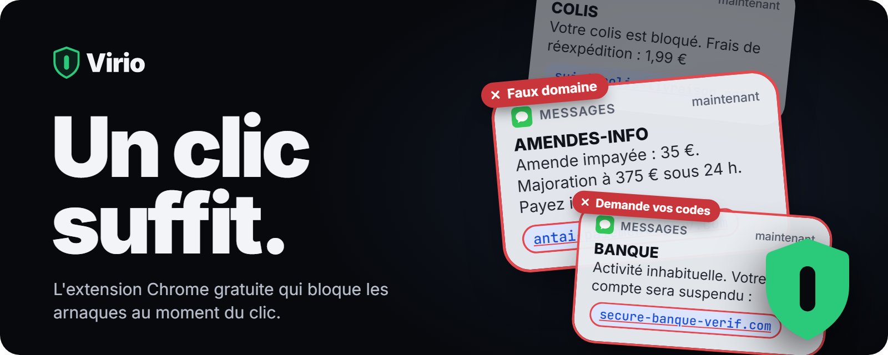
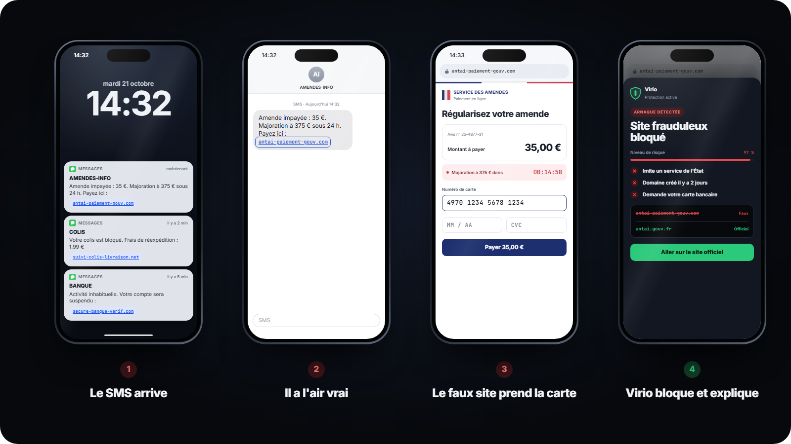
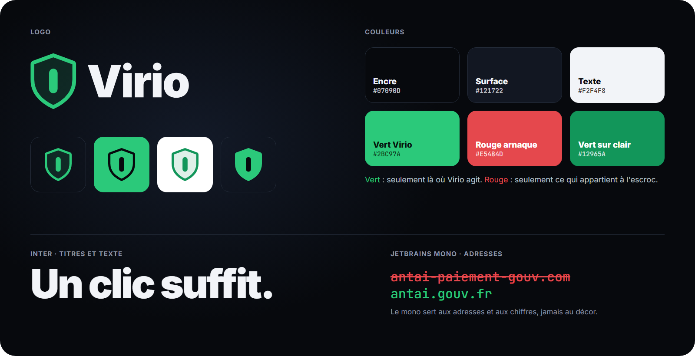

<p align="center">
  
</p>

<p align="center">
  <a href="https://virio.fr"></a>
  
  
</p>

<h3 align="center">Faux SMS d'amende, de colis ou de banque : Virio repère le lien piégé<br>et bloque le faux site avant que vous ne donniez votre carte.</h3>

<br>

## L'arnaque, en 4 écrans



Un nom officiel, un montant précis, une menace de majoration. Le lien ressemble à celui d'un vrai service, la page copie un site de l'État et lance un compte à rebours. **Tout est faux, sauf l'argent qu'on perd.**

Virio intervient entre le clic et la saisie de la carte.

## Ce que fait Virio

<table>
  <tr>
    <td width="33%" valign="top"><h3>Détecte</h3>Au moment où vous cliquez, Virio regarde l'adresse : imite-t-elle un service connu, depuis quand existe-t-elle, que vous demande la page ?</td>
    <td width="33%" valign="top"><h3>Bloque</h3>Le faux site ne s'affiche pas. À la place, un écran clair vous dit ce qui cloche, sans jargon.</td>
    <td width="33%" valign="top"><h3>Redirige</h3>Virio vous montre l'adresse officielle du service imité, pour faire la démarche au bon endroit.</td>
  </tr>
</table>

## Pourquoi maintenant

| Chiffre | Ce que ça représente | Source |
|:--|:--|:--|
| **4,5 Md€** | de préjudice pour les escroqueries enregistrées en France en 2023, deux fois plus qu'en 2016 | SSMSI, ministère de l'Intérieur |
| **411 700** | victimes d'escroqueries et de fraudes aux moyens de paiement en France en 2023 | SSMSI, ministère de l'Intérieur |
| **34 %** | des demandes d'aide des particuliers concernent l'hameçonnage, première menace | Cybermalveillance.gouv.fr |
| **1 030 Md$** | volés par des arnaques dans le monde en 12 mois | GASA & Feedzai |
| **4 %** | des victimes seulement récupèrent leur argent | GASA & Feedzai |

## Gratuit. Pour tout le monde.

Se protéger des arnaques ne devrait rien coûter. Virio est entièrement gratuit : sans abonnement, sans carte bancaire à donner. L'extension Chrome est **bientôt disponible** ; le site permet de s'inscrire pour être prévenu du lancement.

<br>

## Identité visuelle



Une règle tient toute la marque : **le vert, seulement là où Virio agit ; le rouge, seulement ce qui appartient à l'escroc.**

La charte complète (logo, zone de protection, tailles minimales, couleurs et contrastes, typographie, ton de voix) est dans [`brand/charte-graphique.html`](brand/charte-graphique.html), à ouvrir dans un navigateur.

Tout le kit est dans [`brand/`](brand) :

| Dossier | Contenu |
|:--|:--|
| [`brand/logo`](brand/logo) | Symbole et logotypes horizontal et vertical, en SVG et PNG (fond sombre, fond clair, blanc, noir) |
| [`brand/icones`](brand/icones) | Icônes d'application, photos de profil, icônes de l'extension Chrome (16, 32, 48, 128 px) |
| [`brand/reseaux`](brand/reseaux) | Bannières X, LinkedIn, YouTube, Facebook, image de partage, posts et story Instagram |
| [`brand/chrome-web-store`](brand/chrome-web-store) | Vignettes et captures pour la fiche de l'extension |
| [`brand/github`](brand/github) | Les visuels de ce README et l'aperçu social du dépôt |

Chaque visuel a son gabarit HTML dans [`brand/_sources/gabarits`](brand/_sources/gabarits). Pour tout régénérer après une modification :

```bash
python brand/_sources/build_logo.py
python brand/_sources/render.py
```

## Le site

Site statique, sans étape de compilation : HTML, CSS et JavaScript, animations avec GSAP et ScrollTrigger.

| Fichier | Rôle |
|:--|:--|
| `index.html` | La page : le téléphone 3D qui suit le scroll, la démo, les chiffres, le formulaire |
| `css/style.css` | Les styles et les couleurs de la marque |
| `js/main.js` | Le téléphone 3D, l'animation au scroll, la démo protection activée / désactivée |
| `subscribe.php` | Enregistre les inscriptions « Me prévenir » dans `data/inscrits.csv` (dossier fermé au public) |

Pour le voir en local :

```bash
python -m http.server 5173
```

puis ouvrir http://localhost:5173. La mise en ligne est détaillée dans [`docs/mise-en-ligne.md`](docs/mise-en-ligne.md).

## Sources des chiffres

1. SSMSI, ministère de l'Intérieur : escroqueries et fraudes aux moyens de paiement 2016-2023 (juillet 2024), via [La finance pour tous](https://www.lafinancepourtous.com/2024/07/18/fraudes-aux-moyens-de-paiement-et-escroqueries-en-hausse-de-64-entre-2016-et-2023/).
2. Cybermalveillance.gouv.fr : [rapport d'activité 2024](https://www.cybermalveillance.gouv.fr/tous-nos-contenus/actualites/rapport-activite-2024).
3. GASA & Feedzai : [Global State of Scams Report 2024](https://gasa.org/knowledge-base/blog/global-state-of-scams-report-2024-1-trillion-stolen-in-12-months-gasa-feedzai).

<br>

<p align="center">
  <br>
  <b>Virio</b> · Un clic suffit.
</p>
